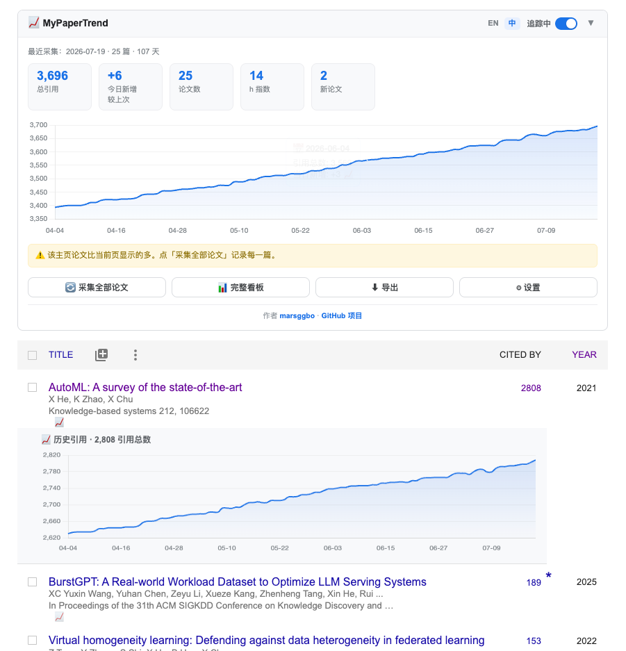

# MyPaperTrend

**Track Google Scholar citations over time — right on the Scholar profile page.**
Zero‑config · local‑first · no scraping API · no server.

English | [中文](#中文)

---

## Why it works where scrapers get blocked

Server‑side scraping of Google Scholar gets CAPTCHA'd fast. MyPaperTrend runs a **content
script that reads the page you already opened** in your own logged‑in session — it makes *no
extra network request*, so there's nothing for Google's anti‑bot to detect.

## Features

- 📈 **Trend panel** on any Scholar profile: total‑citations chart with a hover crosshair
  (date · total · daily new), collapsible and styled to match Scholar.
- 🔍 **Per‑paper history**: a 📈 icon under each paper expands its own citation trend inline —
  open as many as you like.
- 🎯 **Pagination‑proof total**: the headline number comes from Scholar's own metrics box
  (Citations / h‑index / i10), so it's correct even when the paper list is paginated.
- 👥 **Follow any scholar**: flip the **Track** switch on a profile to start recording it. Each
  scholar is stored separately — nobody's data mixes, and nothing is recorded until you switch it on.
- ⏰ **Daily auto‑update**: pick a time; it refreshes every tracked scholar in a hidden tab —
  no API key, runs whenever your browser is open.
- ☁️ **Optional cloud sync**: sign in with **GitHub** or **Google Drive** to sync one JSON file
  per scholar to *your own* account. "Sync now" restores everything on a new computer.
- 🗂 **Full dashboard**: stat cards, all‑time trend, milestones, per‑paper charts, search / sort,
  NEW badges, and a profile switcher.
- 🌐 **English & 中文** — switch language from the panel (EN / 中) or Settings.
- 🔒 **Local‑first & private**: history lives in your browser by default; export / import JSON any time.

## Install (unpacked)

1. Download the latest `MyPaperTrend.zip` from [Releases](../../releases) and unzip it
   (or clone this repo).
2. Open `chrome://extensions` (or `edge://extensions`) and enable **Developer mode**.
3. Click **Load unpacked** and select the folder.
4. Open any [Google Scholar profile](https://scholar.google.com/citations) and flip **Track**.

## Usage

- Every visit to a tracked profile records that day's numbers; revisit over days/weeks to build
  the trend. Click **Capture all pages** to include every paper (not just the first page).
- Open the toolbar **popup** for a quick summary, export/import, and settings.
- **Cloud sync (optional):** Settings → sign in with GitHub or Google Drive. Files are stored
  one‑per‑scholar under your account; on a new machine, sign in and click **Sync now**.

## Privacy

All data stays on your device by default. Nothing is sent anywhere unless you explicitly connect
GitHub or Google Drive (tokens are stored locally, never in a repo). Optional metadata lookups
send only a paper's title to the free Semantic Scholar API.

## How merge / sync works

Sync is a **per‑date union**, not a file overwrite: every date from local and cloud is kept; only
when the *same date* exists in both does one win (local wins ties). So importing old history and
today's data simply combines the timelines — nothing is lost.

## Docs

- [Architecture](docs/DESIGN.md) · [Data contract (schema)](docs/SCHEMA.md)

## License

MIT · Made by [marsggbo](https://marsggbo.github.io/)

---

# MyPaperTrend（中文）

**把 Google Scholar 引用趋势，直接展示在学者主页上。** 零配置 · 本地优先 · 无需爬虫 API · 无需服务器。

## 为什么它不会被封

从服务器爬 Google Scholar 很快就会被弹验证码。MyPaperTrend 用 **content script 读取你已经打开的、
登录状态下的页面**——不发起任何额外请求,所以反爬系统无从检测。

## 功能

- 📈 **趋势面板**:任意学者主页顶部显示总引用曲线,悬停显示「日期 · 总引用 · 当日新增」,可折叠,风格贴合 Scholar。
- 🔍 **每篇论文历史**:每篇论文下方有个 📈 图标,点击就地展开该论文的引用趋势——可同时展开多篇。
- 🎯 **总量分页也准确**:总数取自 Scholar 自己的指标框(引用 / h 指数 / i10),即使论文分页也正确。
- 👥 **追踪任意学者**:在主页打开「追踪」开关才开始记录;每位学者分开存储,数据永不混,不打开就不记录。
- ⏰ **每日自动更新**:设定时间后,用隐藏标签页自动刷新每位已追踪学者——无需任何 API,浏览器开着即可。
- ☁️ **可选云同步**:用 **GitHub** 或 **Google Drive** 登录,把每位学者同步为一个 JSON 文件到你自己的账号;
  换电脑登录后点「立即同步」即可恢复。
- 🗂 **完整看板**:统计卡、总趋势、里程碑、每篇论文图表、搜索/排序、NEW 徽章、学者切换。
- 🌐 **中英文切换**:面板(EN / 中)或设置里切换。
- 🔒 **本地优先、隐私**:数据默认存在浏览器本地;可随时导出/导入 JSON。

## 安装(开发者模式)

1. 到 [Releases](../../releases) 下载 `MyPaperTrend.zip` 解压(或克隆本仓库)。
2. 打开 `chrome://extensions`(或 `edge://extensions`),开启**开发者模式**。
3. 点**加载已解压的扩展程序**,选择该文件夹。
4. 打开任意 [Google Scholar 主页](https://scholar.google.com/citations),打开「追踪」开关。

## 使用

- 每次访问已追踪主页都会记录当天数据;隔几天再看就能积累出趋势。点「采集全部论文」可记录全部论文(不止第一页)。
- 点工具栏图标打开 **popup** 查看摘要、导入/导出、设置。
- **云同步(可选)**:设置 → 用 GitHub 或 Google Drive 登录。文件按学者分别存到你的账号;换电脑登录后点「立即同步」。

## 合并 / 同步逻辑

同步是**按日期取并集**,不是整文件覆盖:本地和云端的每个日期都会保留;只有同一天两边都有时才谈覆盖(以本地为准)。
所以把旧历史和今天的数据放一起,只会把时间线合并起来,**不会丢数据**。

## 文档

- [架构设计](docs/DESIGN.md) · [数据契约(schema)](docs/SCHEMA.md)

## 许可

MIT · 作者 [marsggbo](https://marsggbo.github.io/)
