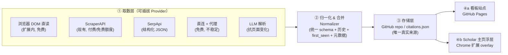

# Scholar Citation Tracker — Chrome 扩展 · 架构方案

> 目标：把「Google Scholar 引用追踪」做成一个通用 Chrome 扩展。用户绑定
> **任意 Scholar 主页 + 一个 GitHub repo**，每天把引用数据以固定 JSON 格式存到该
> repo，并把**引用趋势图直接叠加到 Scholar 主页**上展示。
>
> 关联项目：现有看板 <https://marsggbo.github.io/citation-tracker/>（本扩展复用其数据格式与图表逻辑）。

---

## 0. 一句话设计原则

**解耦「取数」与「用数」，中间用一个固定 JSON 契约连接。**

任何取数方式（provider）只要产出这个契约格式，后面的存储、合并、渲染全部不变。
用户「能提供什么就用什么」——填了 ScraperAPI key 就走 ScraperAPI，没填就走浏览器
DOM 直读，想用 SerpApi / 大模型解析也行。**换 provider 不影响任何下游。**

---

## 1. 总体架构



四层职责：

| 层 | 职责 | 谁实现 |
|---|---|---|
| ① 取数 Provider | 抓当天快照 → 返回固定格式的论文列表 | 扩展 / GitHub Action 都可调用 |
| ② 归一化 Normalizer | 合并进历史、补 `first_seen`、补元数据(作者/摘要/链接) | 共用一套逻辑（JS + Python 两份实现或 WASM 复用） |
| ③ 存储 | `citations.json` 提交到用户的 GitHub repo | 扩展用 GitHub API 写；Action 用 git 提交 |
| ④ 消费 | 画趋势图 | ④a 现有看板；④b 扩展在 Scholar 页注入 |

---

## 2. 关键洞察：为什么扩展能免费绕过 Google 封锁

现有项目用 ScraperAPI，是因为**从服务器**抓 Scholar 会被 Google 封 IP / 弹验证码。
但扩展的 content script 是在**你自己已登录的浏览器**里读你正在浏览的 Scholar 页面
DOM——这就是正常用户访问，天然不触发反爬。

> 因此「浏览器 DOM 直读」是**首选、免费、零服务器**的 provider，可以把 ScraperAPI
> 降级为可选备份。

代价：只有在**你打开自己的 Scholar 主页**时才能抓到当天数据（见 §8 MV3 限制）。

---

## 3. 固定数据契约（所有 provider 必须满足）

分两个层次，边界要清晰：

### 3.1 Provider 输出（只负责「今天的快照」）

Provider 不碰历史、不碰合并，只返回当天抓到的列表：

```jsonc
// ProviderResult
{
  "scholar_id": "AbCdEfGhIjK",
  "fetched_at": "2026-07-19T02:00:00Z",
  "source": "dom",                 // dom | scraperapi | serpapi | proxy | llm
  "papers": [
    {
      "title": "AutoML: A survey of the state-of-the-art",
      "citations": 2808,
      "year": "2021",
      "pub_id": "AbCdEfGhIjK:xxx"  // Scholar citation_for_view id（可选，用于去重/详情链接）
    }
  ]
}
```

### 3.2 存储文件（Normalizer 产出，唯一真实来源）

在现有 `citations.json` 基础上升级为**带版本的包裹结构**（附迁移脚本）：

```jsonc
{
  "schema": 2,
  "profile": { "scholar_id": "AbCdEfGhIjK", "name": "Ada Lovelace" },
  "updated": "2026-07-19",
  "papers": {
    "AutoML: A survey of the state-of-the-art": {
      "year": "2021",
      "pub_id": "AbCdEfGhIjK:xxx",
      "first_seen": "2026-04-04",
      "history": { "2026-04-04": 2630, "2026-07-19": 2808 },
      "meta": {                       // 由元数据 provider 补充（见 §6）
        "authors": ["Xin He", "Kaiyong Zhao", "X. Chu"],
        "venue": "Knowledge-Based Systems",
        "tldr": "A comprehensive review of SOTA AutoML…",
        "abstract": "Deep learning techniques have…",
        "arxiv": "1908.00709", "doi": "10.1016/j.knosys.2020.106622",
        "s2url": "https://www.semanticscholar.org/paper/…",
        "pdf": "https://arxiv.org/pdf/1908.00709"
      }
    }
  }
}
```

> 现有看板的 `citations.json` 是 `schema 1`（顶层直接是 title→entry）。迁移脚本
> `migrate_v1_v2()` 一次性包裹即可；看板前端同步支持两种 schema（读到无 `schema`
> 字段即按 v1 解析），平滑过渡。

---

## 4. 两个正交维度：Fetch × Parse（这才是「支持多种方式」的正解）

用户提到「支持不同爬虫方式 / 用大模型」。这里要澄清一个常被混淆的点：

- **大模型不能自己联网抓页**（除非给它联网工具）。它的价值在**解析**——把抓回来的
  原始 HTML 稳健地提取成固定 schema，抗页面结构变化（现有 regex 一旦 Google 改
  class 名就失效）。

所以把 Provider 拆成两个正交层，自由组合：

| | **Fetch 层（怎么拿到数据）** | **Parse 层（怎么变成 schema）** |
|---|---|---|
| 选项 | 浏览器 DOM · ScraperAPI · SerpApi · 直连+代理 · 联网型 LLM | 内置 regex/DOM 选择器 · **LLM 提取** · SerpApi/S2 本身已结构化(免解析) |
| 运行位置 | 扩展 / Action | 扩展 / Action / 调用外部 LLM API |

**Provider = 一个 Fetcher + 一个 Parser**。设置页让用户分别选，比如
「ScraperAPI 抓 + LLM 解析」或「DOM 抓 + DOM 解析」。

---

## 5. Provider 清单与取舍（诚实版）

| Provider | 免费? | 在哪跑 | 绕过封锁 | 稳定性 | 备注 |
|---|---|---|---|---|---|
| **① 浏览器 DOM 直读** ⭐推荐 | ✅ 完全免费 | 扩展 | ✅ 天然 | 高 | 只在你访问自己 Scholar 页时触发；需处理「显示更多」分页 |
| ② ScraperAPI（现有） | 🟡 免费额度 | Action/扩展 | ✅ | 高 | 作为服务器端每日兜底保留 |
| ③ SerpApi Scholar Author API | 🟡 100/月免费 | Action/扩展 | ✅ | 最高 | 直接返回结构化 JSON（含 cited_by），免解析 |
| ④ 直连 + 免费代理 | ✅ | Action/扩展 | ❌ 常被封/验证码 | 低 | 不推荐做主力 |
| ⑤ Semantic Scholar API | ✅ 免费无 key | Action/扩展 | —（不抓 Scholar） | 高 | **是 S2 自己的引用数 ≠ Google Scholar 数值**；更适合当「元数据源」（作者/摘要/链接），已在现有项目使用 |
| ⑥ 联网型 LLM | 💰 按量 | Action | 视工具而定 | 中 | 成本/稳定性需评估，作为高级可选 |

> **引用口径**要提醒用户：只有 ①②③④ 抓的是 Google Scholar 的引用数；⑤ 是另一套口径。
> 可以支持「主口径 = Scholar，附加口径 = S2」并列展示，但默认应统一到 Scholar。

---

## 6. 元数据补充（作者 / 摘要 / 链接）

与引用抓取分开的一条支线，已在现有 `scrape.py` 落地，可直接搬进扩展：

- 用 **Semantic Scholar** 免费 API 按标题匹配，补 `authors / venue / tldr / abstract /
  arxiv / doi / pdf / s2url`。
- **结果缓存**进 `meta`，只对缺元数据的论文请求，不每天重复。
- 未匹配的论文打 `_tried` 标记，14 天后重试。

---

## 7. 存储层：写入 GitHub 的两条路（同一文件、幂等）

`citations.json` 是唯一真实来源，两条写入路径都遵循同一 Normalizer：

1. **扩展写（客户端，免费闭环）**：你访问 Scholar 页 → DOM provider 抓数 → 拉取 repo
   当前 `citations.json`（含 `sha`）→ 合并 → GitHub Contents API `PUT` 提交。
2. **GitHub Action 写（服务器，每日兜底）**：cron 用 ScraperAPI/SerpApi 抓 → 提交。

**幂等与并发**：以「当天日期是否已存在」为幂等键；写前先读最新 `sha` 再 `PUT`，
遇 409 冲突则重读重试。避免 Action 与扩展同日双写打架。

---

## 8. Chrome 扩展结构（MV3）

```
scholar-tracker-extension/
├─ manifest.json              # MV3；host_permissions + storage + alarms
├─ src/
│  ├─ options.html/.js        # 绑定 scholar_id + repo + PAT + 选择 provider
│  ├─ content.js              # 注入 Scholar 页：DOM 抓数(可选) + 拉 JSON + 画 overlay
│  ├─ background.js           # chrome.alarms 定时；GitHub 提交调度
│  ├─ core/
│  │  ├─ schema.js            # 契约类型 + migrate_v1_v2
│  │  ├─ normalizer.js        # 合并历史 / first_seen / 幂等
│  │  ├─ github.js            # Contents API 读/写（带 sha）
│  │  └─ providers/
│  │     ├─ dom.js  scraperapi.js  serpapi.js  llm.js
│  │     └─ metadata_s2.js
│  ├─ ui/chart.js             # 复用现有看板的 Chart.js 逻辑 + 十字准线 tooltip
│  └─ lib/chart.min.js        # 本地打包（MV3 CSP 禁 CDN 外链）
└─ docs/DESIGN.md             # 本文档
```

**manifest 权限（最小化）**：
- `host_permissions`: `https://scholar.google.com/*`, `https://api.github.com/*`,
  `https://raw.githubusercontent.com/*`, （元数据）`https://api.semanticscholar.org/*`
- `permissions`: `storage`, `alarms`, `activeTab`

**overlay**：在 Scholar 主页顶部（`#gsc_prf` 或引用统计区旁）注入一块面板，画总趋势
+ 每篇 sparkline，悬停显示「日期 / 引用总数 / 当日新增」——直接复用现有看板已经做好的
crosshair + tooltip 逻辑。

---

## 9. 配置与密钥安全

- **GitHub PAT**：用 fine-grained，**只授权目标 repo 的 Contents: Read/Write**。存
  `chrome.storage.local`（不用 `sync`，避免跨设备同步泄露）。
- **ScraperAPI / SerpApi key**（若用）：同样存本地，绝不写进 repo。
- 文档明确提醒：**不要把任何 token 提交进代码/`.git/config`**
  （对应之前 citation-tracker 本地 remote 里明文 PAT 的教训——建议尽快吊销那个）。

---

## 10. MV3 限制 & 「每天更新」的现实

- MV3 的 background 是短命 service worker，`chrome.alarms` 只在**浏览器开着**时触发。
- 所以扩展的真实语义是「**你访问 Scholar 页 / 浏览器运行时** → 顺手更新」。
- **保证每日不断档**仍建议保留 GitHub Action 作兜底。扩展负责「看到即更新 + 展示」，
  Action 负责「你没开浏览器的日子也有数据」。两者写同一文件，互补。

---

## 11. 分阶段路线图

| 阶段 | 内容 | 价值 |
|---|---|---|
| **P0 MVP** | 扩展 overlay-only：读 repo 的 `citations.json`，把趋势图画到 Scholar 主页 | 最快见效，零风险 |
| **P1** | DOM provider + GitHub 写入（访问即更新，免费闭环，可脱离 ScraperAPI） | 免费自动化 |
| **P2** | Provider 抽象（DOM/ScraperAPI/SerpApi/LLM 可选）+ 设置页选择 + schema v2 | 通用化、可插拔 |
| **P3** | 多 Scholar profile、里程碑通知、导出、S2 并列口径 | 增强 |
| 并行 | 把现有 `scrape.py` 重构成同一 Fetcher+Parser 接口，Action 复用 | 两端共用一套逻辑 |

---

## 13. 决策锁定（2026-07-19）

- **默认体验 = 零配置**：用户安装扩展 → 打开自己的 Scholar 主页 → 扩展用 **DOM 直读**
  抓数、**存本地 `chrome.storage.local`**（`unlimitedStorage`）、在页面上叠加趋势图。
  **不需要任何账号 / API key / GitHub。**
- **默认取数** = 浏览器 DOM 直读；**兜底** = 用户自带的 API（ScraperAPI / SerpApi / …）。
- **默认存储** = 本地；**可选** = 用户自定义位置（Google Drive / GitHub / 未来托管后端）。
- **数据格式写死** = 见 [`SCHEMA.md`](SCHEMA.md)。取数、存储可以随用户换，但**格式和渲染接口是固定契约**，任何后端存的都是同一份 JSON，渲染层只认这份契约。

### 13.1 首次运行引导（必须）

- 用户**第一次打开扩展**（或首次访问 Scholar 主页）必须弹出**引导页 / onboarding**：
  1. 一句话说明扩展做什么（在你的 Scholar 主页上叠加引用趋势）。
  2. 说明**默认把数据存在本地**、隐私不外发、可随时导出。
  3. 提供「开始使用」（零配置）与「高级设置」（连 Google Drive / GitHub / 自带 API）两个入口。
- 实现：`chrome.storage.local` 里存一个 `onboarded: true` 标志；未设置则 `chrome.runtime.onInstalled`
  打开 `onboarding.html`。

### 13.2 高级设置（可选，不挡默认路径）

- **自带取数 API**：用户可在设置页填 ScraperAPI / SerpApi key，选作兜底或主力 Fetcher。
- **自定义存储位置**：Local（默认）/ Google Drive / GitHub，可多选并存（双写）。
- 无论选什么,**写入的 JSON 必须符合 [`SCHEMA.md`](SCHEMA.md)**——这是硬约束。

---

## 12. 待你拍板的问题

1. **schema 是否升级到带 `schema:2` 的包裹结构**（我建议是，并给 v1→v2 迁移 + 看板兼容）。
2. **扩展默认取数方式**：DOM 直读为主 + ScraperAPI 兜底？还是你想让 SerpApi 做主力？
3. **是否上架 Chrome Web Store**（影响权限最小化和审查）还是**自用 unpacked** 即可。
4. **引用口径**：只认 Google Scholar，还是允许 Semantic Scholar 作为并列口径展示。
5. **归一化逻辑**要不要做成两端共用（JS 一份 + Python 一份，或抽成 WASM/独立包）。
6. 新 repo 命名与是否现在建 GitHub 远程（当前只在本地 `git init`）。
